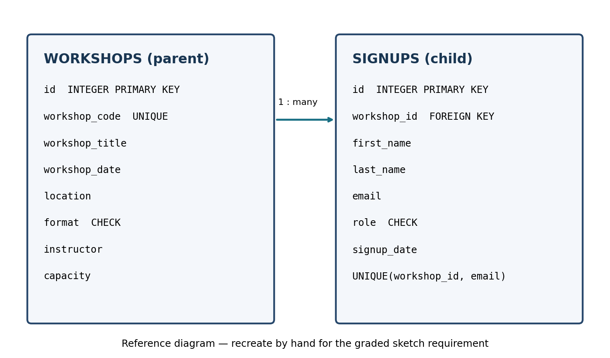

# CIT 105 — Module 7: SQLite Database Construction

Normalized SQLite database created from `workshop_signups.csv`.

## How to run

```bash
python load.py
python -m sqlite3 workshops.db
```

Run the statements in `queries.sql` individually and in order. Statements 6–8 intentionally modify the database; the included `workshops.db` is the **pre-query baseline**.

## Dataset and import results

- CSV rows: 39
- Workshops imported: 8 (including 2 without attendees)
- Valid unique attendee signups: 35
- Rejected: 2 (missing email on WS103; duplicate email for WS104)
- Empty attendee rows: 2 (WS107 and WS108), retained as workshops

## Query outputs (captured on a temporary copy of the baseline database)

### 1. List every workshop, with the most recent first.

| workshop_code | workshop_title | workshop_date | location |
| --- | --- | --- | --- |
| WS108 | Prompt Writing for Developers | 2026-11-14 | Online (Zoom) |
| WS107 | Resume Review for IT Careers | 2026-11-07 | Room 110 |
| WS106 | Network Troubleshooting with Wireshark | 2026-10-31 | Computer Lab A |
| WS105 | Azure Fundamentals Lab | 2026-10-17 | Computer Lab A |
| WS104 | SQL Joins Clinic | 2026-10-10 | Computer Lab B |
| WS103 | Linux Command Line Basics | 2026-10-03 | Online (Zoom) |
| WS102 | Python for Data Cleaning | 2026-09-26 | Room 204 |
| WS101 | Intro to Git and GitHub | 2026-09-12 | Computer Lab B |

### 2. Count the attendees on each workshop, including workshops with none.

| workshop_code | workshop_title | attendee_count |
| --- | --- | --- |
| WS101 | Intro to Git and GitHub | 6 |
| WS102 | Python for Data Cleaning | 6 |
| WS103 | Linux Command Line Basics | 7 |
| WS104 | SQL Joins Clinic | 9 |
| WS105 | Azure Fundamentals Lab | 4 |
| WS106 | Network Troubleshooting with Wireshark | 3 |
| WS107 | Resume Review for IT Careers | 0 |
| WS108 | Prompt Writing for Developers | 0 |

### 3. List every attendee together with the title of the workshop they signed up for, using a join.

| id | first_name | last_name | email | workshop_title |
| --- | --- | --- | --- | --- |
| 1 | Maria | Gonzalez | mgonzalez@au.edu | Intro to Git and GitHub |
| 2 | James | Carter | jcarter@au.edu | Intro to Git and GitHub |
| 3 | Sofia | Ramirez | sofia.ramirez22@gmail.com | Intro to Git and GitHub |
| 4 | Kevin | Nguyen | knguyen@au.edu | Intro to Git and GitHub |
| 5 | Laura | Fernandez | lfernandez@au.edu | Intro to Git and GitHub |
| 6 | Andre | Thompson | andre.t@outlook.com | Intro to Git and GitHub |
| 7 | Maria | Gonzalez | mgonzalez@au.edu | Python for Data Cleaning |
| 8 | Diego | Morales | dmorales@au.edu | Python for Data Cleaning |
| 9 | Priya | Patel | ppatel@au.edu | Python for Data Cleaning |
| 10 | Nicole | Brooks | nbrooks@au.edu | Python for Data Cleaning |
| 11 | Luis | Herrera | lherrera@au.edu | Python for Data Cleaning |
| 12 | Tom | Walsh | tom.walsh@yahoo.com | Python for Data Cleaning |
| 13 | Kevin | Nguyen | knguyen@au.edu | Linux Command Line Basics |
| 14 | Aisha | Johnson | ajohnson@au.edu | Linux Command Line Basics |
| 15 | Carlos | Vega | carlosvega.dev@gmail.com | Linux Command Line Basics |
| 16 | Emily | Chen | echen@au.edu | Linux Command Line Basics |
| 17 | Rafael | Castro | rcastro@au.edu | Linux Command Line Basics |
| 18 | Omar | Haddad | ohaddad@au.edu | Linux Command Line Basics |
| 19 | Valentina | Rossi | vrossi@au.edu | Linux Command Line Basics |
| 20 | Diego | Morales | dmorales@au.edu | SQL Joins Clinic |
| 21 | Aisha | Johnson | ajohnson@au.edu | SQL Joins Clinic |
| 22 | Brian | Lee | brian.lee88@outlook.com | SQL Joins Clinic |
| 23 | Natalia | Suarez | nsuarez@au.edu | SQL Joins Clinic |
| 24 | Emily | Chen | echen@au.edu | SQL Joins Clinic |
| 25 | Michael | Ward | mward@au.edu | SQL Joins Clinic |
| 26 | Gabriel | Silva | gsilva@au.edu | SQL Joins Clinic |
| 27 | Hannah | Price | hannah.price@gmail.com | SQL Joins Clinic |
| 28 | Isabel | Mendoza | imendoza@au.edu | SQL Joins Clinic |
| 29 | Omar | Haddad | ohaddad@au.edu | Azure Fundamentals Lab |
| 30 | Ricardo | Pena | rpena@au.edu | Azure Fundamentals Lab |
| 31 | Chloe | Martin | chloe.martin@yahoo.com | Azure Fundamentals Lab |
| 32 | Priya | Patel | ppatel@au.edu | Azure Fundamentals Lab |
| 33 | James | Carter | jcarter@au.edu | Network Troubleshooting with Wireshark |
| 34 | Fatima | Ali | fali@au.edu | Network Troubleshooting with Wireshark |
| 35 | Sergio | Blanco | sergio.blanco@proton.me | Network Troubleshooting with Wireshark |

### 4. Find every attendee whose email address is not from the au.edu domain.

| id | first_name | last_name | email |
| --- | --- | --- | --- |
| 3 | Sofia | Ramirez | sofia.ramirez22@gmail.com |
| 6 | Andre | Thompson | andre.t@outlook.com |
| 12 | Tom | Walsh | tom.walsh@yahoo.com |
| 15 | Carlos | Vega | carlosvega.dev@gmail.com |
| 22 | Brian | Lee | brian.lee88@outlook.com |
| 27 | Hannah | Price | hannah.price@gmail.com |
| 31 | Chloe | Martin | chloe.martin@yahoo.com |
| 35 | Sergio | Blanco | sergio.blanco@proton.me |

### 5. Find the workshop with the largest number of attendees.

| workshop_code | workshop_title | attendee_count |
| --- | --- | --- |
| WS104 | SQL Joins Clinic | 9 |

### 6. Update one workshop's location, changing exactly one row.

Rows updated: 1

| workshop_code | location |
| --- | --- |
| WS101 | Computer Lab C |

### 7. Delete a single attendee by id, and show that their workshop still exists afterward.

Rows deleted: 1

| workshop_code | workshop_title |
| --- | --- |
| WS101 | Intro to Git and GitHub |

### 8. Insert a new workshop with no attendees, proving the insert anomaly is gone.

| workshop_code | workshop_title | attendee_count |
| --- | --- | --- |
| WS109 | Database Design Practice | 0 |

## Foreign key test

`PRAGMA foreign_keys = ON;` confirmed. Inserting a signup with nonexistent `workshop_id=99999` was rejected: `FOREIGN KEY constraint failed`.

## Schema reference



**Academic submission note:** The diagram is computer-generated and is not a hand-drawn sketch. If the instructor still requires a handwritten drawing committed before SQL, make and commit that yourself; uploading this package together does not satisfy the historical commit-order requirement.

## Import log

```text
WARNING: Rejected CSV line 19 (WS103): incomplete attendee record
WARNING: Rejected CSV line 28 (WS104): UNIQUE constraint failed: signups.workshop_id, signups.email
INFO: CSV line 39: workshop WS107 has no attendees
INFO: CSV line 40: workshop WS108 has no attendees
INFO: Imported 35 attendees; rejected 2 rows
INFO: Workshops: 8
```
